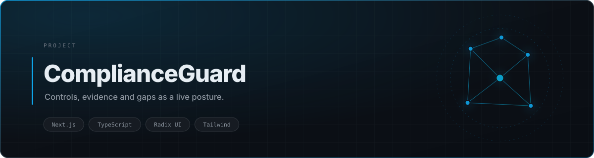
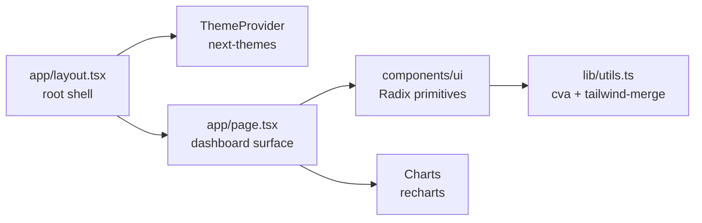

<div align="center">

<picture>
  <source media="(prefers-color-scheme: dark)" srcset="./assets/banner-dark.svg">
  <source media="(prefers-color-scheme: light)" srcset="./assets/banner-light.svg">
  
</picture>

<br>


<br><br>

<a href="https://complianceguard.vercel.app"><b>Live Demo</b></a> · <a href="#quick-start">Quick Start</a> · <a href="#architecture">Architecture</a>

</div>

## Overview

Compliance work dies in spreadsheets. A control lives in one file, its evidence in a shared drive, its owner in someone's inbox, and the actual posture — *are we ready or not* — exists only in the head of whoever last read all three.

**ComplianceGuard** collapses that into one surface: controls, evidence, and gaps resolve into a single live posture you can read in a glance.

This repository is the **interface layer** — a focused, production-styled dashboard built on the Next.js App Router with a fully typed component system. It is intentionally scoped to the presentation and interaction model; the persistence and evidence-ingestion services are not included.

## Key Features

| | |
|---|---|
| **Posture-first layout** | Readiness is the headline, not a buried metric — controls roll up into an overall score |
| **Evidence tracking** | Each control carries its evidence state, so a gap is visible before an auditor finds it |
| **Typed component system** | Built on Radix primitives with `class-variance-authority`, so variants are typed rather than stringly-typed |
| **Accessible by default** | Radix primitives give keyboard navigation, focus management, and ARIA semantics without hand-rolled workarounds |
| **Dark and light** | `next-themes` with a system-aware provider and no flash on load |

## Architecture



The App Router renders a single dashboard route. `components/ui` holds the primitive layer; `app/page.tsx` composes it. This keeps the design system reusable if the app grows into multiple routes.

## Project Structure

```text
.
├── app/
│   ├── layout.tsx          # root shell + theme provider
│   ├── page.tsx            # compliance dashboard
│   └── globals.css
├── components/
│   ├── ui/                 # Radix-based primitives
│   └── theme-provider.tsx
├── lib/utils.ts            # cn() helper
├── styles/globals.css
└── next.config.mjs
```

## Quick Start

```bash
git clone https://github.com/tribetorkoz/compliance-guard.git
cd compliance-guard
pnpm install
pnpm dev                  # http://localhost:3000
```

<details>
<summary><b>Why pnpm</b></summary>

The lockfile is `pnpm-lock.yaml`. Using npm or yarn will resolve a different dependency tree than the one this was built against.
</details>

<details>
<summary><b>Build for production</b></summary>

```bash
pnpm build
pnpm start
```
</details>

## License

MIT
